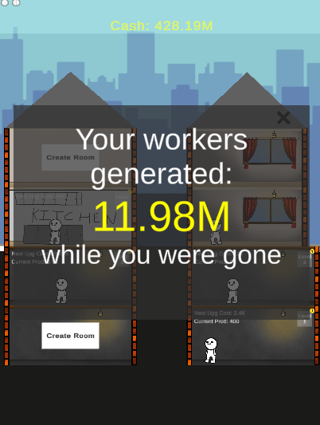
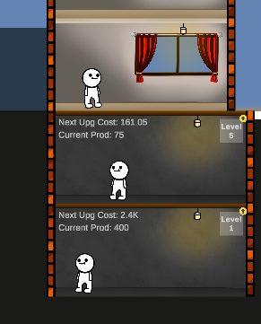
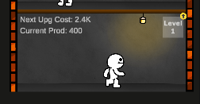

# Idle Clones game
Incremental game made in Unity

## Gameplay loop:
 - start with $150
- build Generators, Kitchens and Sleeping Quarters in room slots
- upgrade rooms
- balance food and energy, or a bottleneck slows production
- buy an expansion for a second house
- collect offline earnings

## Features
### economy & progression
- exponential progression 
- milestone multipliers
- data-driven balance tables
- formatting of numbers
### bottleneck system
- capacity of rooms compared against clone demand
- static c# event (RoomManager.BottleneckChange) broadcast to all generators
- levels of penalty
### save system & offline progress
- auto save every 30s, save on quit
- world rebuilt from save file
- offline earnings worked out from time away
### expansions
- house grows and expands, more rooms
### living clones
- hand drawn walk animation cycle
### mobile camera
- drag to pan, pinch or zoom
- clamped to world bounds
- bounds tuned for each device
- panning locked while menus open
### audio
- audiomanager
- overlapping sounds

